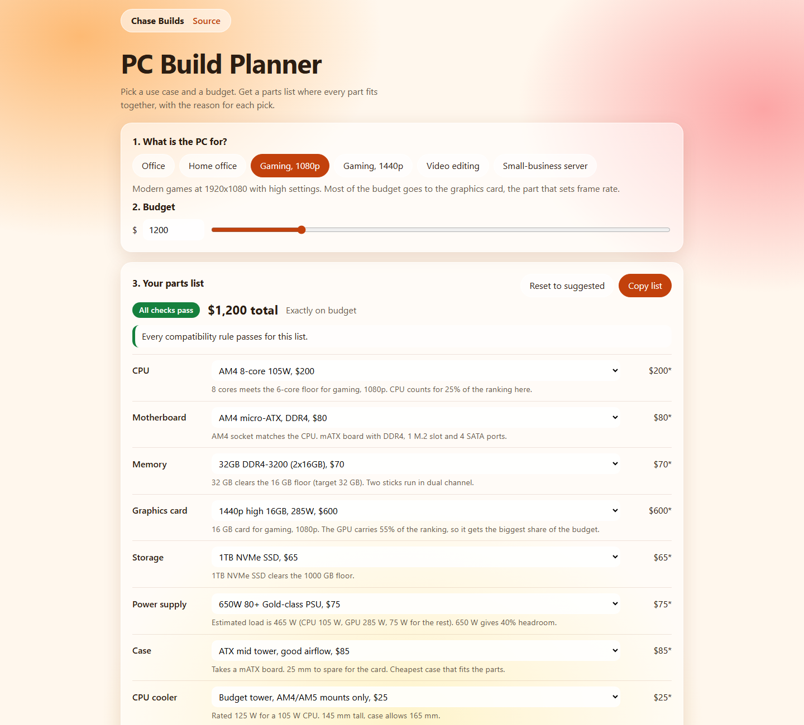

# PC Build Planner

[](https://github.com/chasebuilds/pc-build-planner/actions/workflows/ci.yml)
[](https://chasebuilds.github.io/pc-build-planner/)

Pick a use case and a budget. The planner returns a parts list where every part fits together, says why each part was chosen, and re-checks the whole list when you swap a part. It is a static page: no backend, no account, no network calls.

**Live demo:** https://chasebuilds.github.io/pc-build-planner/



## What it does

- Use cases: office, home office, gaming 1080p, gaming 1440p, video editing, small-business server.
- Picks the highest-ranked build that fits the budget and passes every compatibility rule with no warnings.
- Shows a plain-language reason for each part, and updates it when you swap one.
- Every part has a drop-down. Options that would break the build are marked "(conflict)". Pick one anyway and the problem shows up in the checks list.
- If the budget is too low, it says what the cheapest compatible build costs.
- Copy the list as plain text to send to a customer or paste into a quote.

## Compatibility rules

Each rule is a small pure function in [`src/rules.ts`](src/rules.ts) and has its own tests in [`tests/rules.test.ts`](tests/rules.test.ts).

| Rule | Error when | Warning when |
| --- | --- | --- |
| complete | a required part is missing | |
| socket | CPU socket differs from the board | |
| ram-type | DDR4/DDR5 does not match the board | |
| ram-speed | | kit is faster than the board supports |
| ram-slots | more sticks than slots, or more GB than the board takes | |
| case-form | board form factor is not supported by the case | |
| gpu-length | card is longer than the case allows | under 10 mm to spare |
| gpu-present | CPU has no integrated graphics and no card is chosen | |
| psu-wattage | PSU is below estimated load (CPU + GPU + 75 W) | under 25% headroom |
| cooler-height | cooler is taller than the case allows | under 5 mm to spare |
| cooler-socket | cooler has no mount for the CPU socket | |
| cooler-capacity | | cooler rating is below CPU TDP |
| storage-interface | more NVMe drives than M.2 slots, or more SATA drives than ports | |

## How the planner picks

1. Try every CPU, board, RAM kit, graphics card and drive that meets the use case minimums (cores, RAM, storage, GPU class).
2. For each, add the cheapest PSU, case and cooler that pass every rule with no warnings.
3. Keep builds at or under budget and rank them by a weighted score (CPU, GPU, RAM, storage weights per use case, in [`src/profiles.ts`](src/profiles.ts)). Ties go to the lower price.

The catalog ([`src/data/catalog.json`](src/data/catalog.json)) has 65 generic part classes, such as "AM5 8-core 105W" or "1440p 12GB, 220W", with realistic spec fields. No brands, no model numbers. The `perf` numbers are rough rankings I chose for ordering, not benchmark results.

## Run it

```bash
npm ci
npm run dev        # local dev server
npm test           # Vitest, 50 tests
npm run lint       # ESLint
npm run typecheck  # TypeScript strict
npm run build      # production build in dist/
```

CI runs lint, typecheck, tests and build on every push. A second workflow deploys `dist/` to GitHub Pages.

## Limitations

- **Prices are example placeholders.** They are not live and not from any store. Check current prices before buying anything. The planner never fetches prices.
- **The catalog is generic and small.** 65 part classes, 3 CPU sockets, no specific products. Real stock, real model quirks and BIOS support are not modeled.
- **PSU sizing is an estimate.** Load is CPU TDP + GPU TDP + a fixed 75 W. Transient spikes, connector counts and efficiency are not modeled.
- **Not modeled:** liquid coolers and radiator support, case fan and drive bay counts, GPU slot width, M.2 sharing SATA lanes, CPU/BIOS version support, PCIe lane limits, RAM compatibility lists, Wi-Fi, OS licenses and monitors.
- **Performance scores are rankings, not benchmarks.** Treat the build as a starting point and have it reviewed before you order.

## License

MIT, see [LICENSE](LICENSE).
